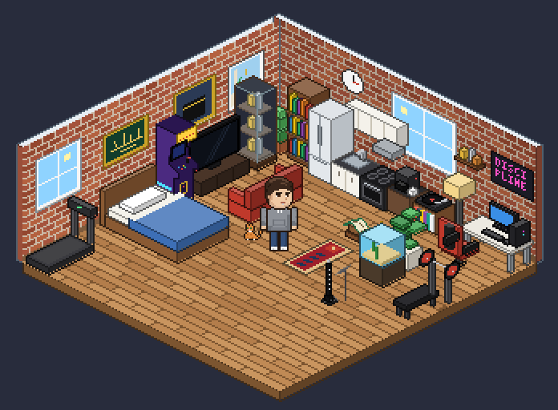

# Discipline Quest

A Habbo-style pixel room that reflects how disciplined you are. Your avatar walks to the prayer rug, the bed, or the kitchen counter when you check things off. Stay consistent and the room fills with furniture, a red convertible and a pony. Slip and it goes dark and messy.



## What it tracks

| Habit | How it works (strict mode) |
| --- | --- |
| 5 daily prayers | Check each one off. +5 coins each, +10 bonus for all five. Each unchecked prayer at midnight costs 10. |
| Wake up at 08:30 | Tap **I'm up** by 08:45 for +15. Late or no check-in costs 20 and resets the streak. |
| Quit porn | Days-clean counter. **I feel an urge** opens a 60-second urge-surfing screen (+5, up to 5×/day). **I relapsed** costs 100, resets the streak, locks your newest item for 7 clean days and makes the room gloomy. |
| Diet | Log meals as on-plan or cheat. Evening check-in (opens 18:00) gives +15. A cheat meal or no check-in costs 20. |
| Custom habits | Add your own daily habits in Settings. +5 when done, −5 when missed. |

| Gym | One tap per visit. 4 visits a week (Mon–Sun) or lose 30 coins. Full weeks grow your body through 5 stages; two missed weeks in a row drop a stage. |
| Quran | Log pages with +/−. Daily goal (default 2) or −10. A khatm bar counts to 604 pages. |
| Bedtime | Check in between 21:00 and 23:30. Late or missed costs 15. The avatar goes to sleep. |
| Jumu'ah / Ramadan | Friday Dhuhr becomes Jumu'ah with a bonus. Ramadan mode adds fasting and taraweeh check-ins. |

- Days you don't open the app still count as full misses.
- Coins can go negative. While in debt the catalog is closed.
- **Cars** (parked in the garage outside): 2016 Mini Cooper from day one, 2016 Infiniti Q50 at 30 clean days, 2027 Hyundai Ioniq 5 at 90 clean days.

## Progression

- **Catalog**: about 50 items across furniture, a faith corner, wall decor, wallpapers, floors, prayer rugs, car paint and a cat. Many are gated by level.
- **Rooms**: Studio (8×8) → Apartment (10×10, second window) → Penthouse (12×12, city skyline). Some furniture needs a bigger room.
- **Wardrobe**: six outfits (coat, hoodie, gym, thobe + kufi, leather jacket, navy suit).
- **Badges**: 29 badges for prayer, purity, mornings, diet and general milestones. Each pays coins and XP.
- **Daily quests**: three bonus quests a day, the same all day. Undoing the work takes the reward back.
- **Decorate**: move, rotate or store any furniture, including the bed, kitchen and rug. Placement can't block the way.
- **Use things**: tap the treadmill, bookshelf (read on the sofa), clarinet, PC, arcade, record player, TV, coffee, weight bench or aquarium and the avatar uses it.
- **Planner**: Stats shows how many days until everything is unlocked (about 100 at a strong pace).
- **Room life**: tap the rug, bed or kitchen to log things. The avatar prays (takbir, qiyam, sitting), sleeps until you check in, and the room gets darker at night with lamps and screens glowing.

## Tech

Next.js 14 · TypeScript · Tailwind · Zustand (persisted to localStorage) · `@ducanh2912/next-pwa`.

There are no image assets. The avatar, pony, furniture and room are all drawn in code:

- `src/game/sprites/avatar.ts` – the avatar, drawn as pixel grids (colors in `palette.ts`)
- `src/game/iso.ts` – pixel-exact isometric box rasterizer
- `src/game/furniture.ts` – every piece of furniture, the room and the layout
- `src/engine/` – pure game rules, catalog, badges, quests and save migration, with tests

## Run

```bash
npm install
npm run dev               # http://localhost:3000
npm test                  # engine tests
npm run build             # production build + service worker
npm run preview-sprites   # renders rooms + catalog to .preview/
npm run build:single      # one self-contained HTML page in dist/
npm run icons             # regenerates PWA icons from the avatar
```

**Testing time-based rules:** add `?now=2026-10-11T08:20` to the URL to pin the app clock for that tab. `?now=reset` clears it.

## Install on your phone

Deploy (e.g. `vercel` from this folder), open the URL on your phone, then use Share → Add to Home Screen (iOS) or Install app (Android). Data is stored only on that device, so use **Settings → Copy backup** and keep it somewhere safe.
